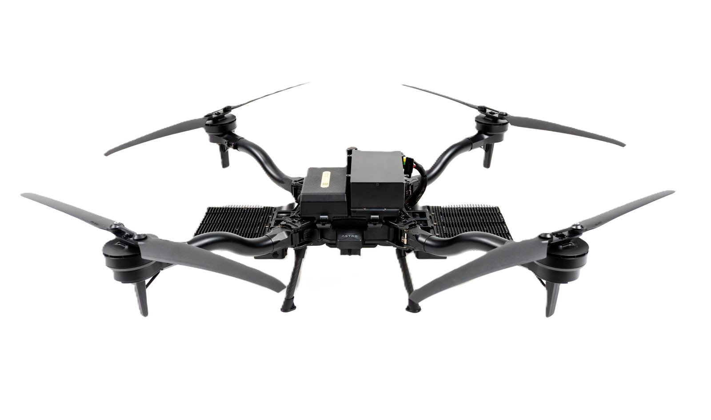

# System Overview

## FS500 Aircraft

The FS500 utilizes the capable Astro platform as the base for the platform


A thorough understanding of the [Astro Pilot Handbook](https://app.gitbook.com/o/-LYU75KLzw4BcaiMGVz2/s/8dwrGJhxGd9cIvsStziq/) is required prior to operation


<figure><figcaption>
Astro with FS500
</figcaption></figure>

### Light Panel Assembly

The FS500 illumination system includes two light panel assemblies mounted on either side of the aircraft.

* Assembly Components: Each light panel assembly contains:
  * 1x LED Driver
  * 4x Light Leaves
* Maintenance: The light leaves are field-replaceable. See the [Maintenance section](maintenance.md) for replacement instructions.

<figure><figcaption>
FS500 Lighting assembly and a single leaf
</figcaption></figure>

### Strain Relief Mounting Point

The tether cable clips into the strain relief mounting point located on the bottom of the aircraft. This is a critical component that absorbs pulling and twisting forces from the tether, preventing tension from damaging the high-voltage connector and ensuring a secure, safe connection during flight

<figure><figcaption>
Location of the Strain Relief Mounting Point
</figcaption></figure>


To protect the high-voltage connection, the tether cable must be secured in the strain relief mounting point on the aircraft's underside. This point is engineered to relieve tension and absorb mechanical stress from flight maneuvers. Failing to use it can lead to cable damage, power failure, or disconnection of the tether.


## Pilot Pro&#x20;

While Pilot Pro functionality is similar to standard Astro operation, key changes have been implemented to optimize FS500 performance:

1. Updated D2 knob for light control.
2. S2 switch in down position toggles light's thermal protection on.
3. Flying Sun's included Pilot Pro is pre-installed with [Flying Sun app](https://app.gitbook.com/o/-LYU75KLzw4BcaiMGVz2/s/-LaNHxABbg20hfA0zTDQ/~/changes/956/products/flying-sun-500/flying-sun-app).&#x20;


This section assumes familiarity with the Pilot Pro controller. For a complete guide on its operation, [click here](https://app.gitbook.com/o/-LYU75KLzw4BcaiMGVz2/s/LOjX8tKksBBX9flThLp2/)


<figure><figcaption>
Location of D2 dial, which controls lighting with FS500
</figcaption></figure>

## 3kW Tether System&#x20;

The FS500 utilizes a 3kW Tether System, which is engineered to deliver a continuous power supply to the aircraft for extended, uninterrupted flight.

#### Ground Unit&#x20;

1. Main power breaker switch.
   1. Turn the Ground Unit on/off
2. Backup power charging port.
   1. Ensure backup battery is charged
   2. AC-DC charger included in the case
3. Backup power switch.&#x20;
   1. Maintains tether tension during power loss
   2. Used for recalling the cable after FS500 use
4. Main input power cable port.
   1. NEMA L14-30P connector installed

<figure><figcaption>
3kW Tether
</figcaption></figure>

<figure><figcaption>
[Left] Tether wire between Tether and Astro         [Right] Power for Tether system
</figcaption></figure>

### Air Unit

The Air Unit connects to Astro via the top chassis interface. In addition, it includes two dedicated connections to interface with the tether and lights:

1. The XT-60 located at the end of the tether cable will be plugged into the XT-60 on the air unit.
2. The XT-90 on the light panel cable plugs into the XT-90 on the side of the air unit.&#x20;

<figure><figcaption>
FS500 Air Unit
</figcaption></figure>
